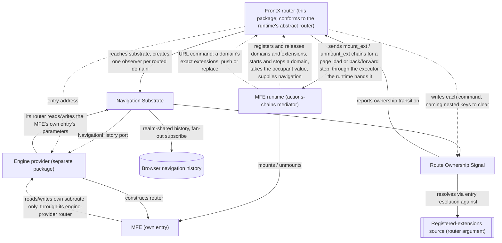

# Technical Design — Routing

- [ ] `p3` - **ID**: `cpt-frontx-routing-design-routing`

<!-- toc -->

- [1. Architecture Overview](#1-architecture-overview)
  - [1.1 Architectural Vision](#11-architectural-vision)
  - [1.2 Architecture Drivers](#12-architecture-drivers)
  - [1.3 Architecture Layers](#13-architecture-layers)
- [2. Principles & Constraints](#2-principles--constraints)
  - [2.1 Design Principles](#21-design-principles)
  - [2.2 Constraints](#22-constraints)
  - [2.3 Obligations On The FrontX Router](#23-obligations-on-the-frontx-router)
- [3. Technical Architecture](#3-technical-architecture)
  - [3.1 Domain Model](#31-domain-model)
  - [3.2 Component Model](#32-component-model)
  - [3.3 API Contracts](#33-api-contracts)
  - [3.4 Internal Dependencies](#34-internal-dependencies)
  - [3.5 External Dependencies](#35-external-dependencies)
  - [3.6 Interactions & Sequences](#36-interactions--sequences)
  - [3.7 Database schemas & tables](#37-database-schemas--tables)
- [4. Additional context](#4-additional-context)
  - [Worked Example: The Reference Link](#worked-example-the-reference-link)
  - [Worked Example: A Console Layout And Its URL](#worked-example-a-console-layout-and-its-url)
  - [Worked Example: Structural Reset](#worked-example-structural-reset)
- [5. Traceability](#5-traceability)

<!-- /toc -->

## 1. Architecture Overview

### 1.1 Architectural Vision

`@gears-frontx/routing` keeps an agnostic navigation core behind an opaque substrate port, with the concrete router engine supplied by a separately published provider package. The navigation substrate never depends on a concrete engine, and a separately published engine-provider package satisfies the substrate's own history contract; the ecosystem provides a default implementation of it.

Throughout this package's own artifacts, *navigation substrate* names the agnostic core component alone, described below; the published package `@gears-frontx/routing` is that core plus the Route Ownership Signal and the FrontX router, each described below. An engine provider is never part of this package — it is a distinct published member that depends on this one, never the reverse. (The root DESIGN and `cpt-frontx-adr-core-package-boundaries` use the term *navigation substrate* at package granularity, naming the whole published library — a broader use than this document's own; see root DESIGN §1.3.)

#### A tree of domains, resolved level by level

A composed application is a tree of extension domains, not a single flat placement. An extension mounted into a domain owns a zone, and that zone may itself contain further domains, so the tree nests to whatever depth the composed application actually has. A level is one domain identified by its own domain key. Route ownership resolution runs at every level independently, never once against the whole URL: a level's own resolution reads only the entries carrying its own domain key — the domain's own declared route, a single `name` at any depth, unique among the routed domains live in the page — and matches each such entry's own extension token against that domain's own registered routable extensions (`cpt-frontx-algo-routing-route-ownership-signal-entry-resolution`), naming the entry's route owner when a registered extension matches and naming none when none does. A domain's own registered extensions are never a global registry the Route Ownership Signal holds: they are a plain argument the FrontX router supplies at observer creation, which the observer reads afresh at each resolution, scoped to that one domain. The Route Ownership Signal holds no registry of levels either, and publishes no aggregated "the whole URL resolved" signal — resolving a deep URL is a wave through the tree, not one event, and a nested domain's own observer exists only once its enclosing extension has actually mounted (§3.6). The FrontX router's own copy of the registrations is described in §3.1 (Router registrations). An entry's own payload — every parameter beyond the fact of occupancy — is never part of what any level's own resolution matches: it is the private data of the one occupant that entry addresses, opaque to resolution and belonging entirely to that occupant and to whichever engine-provider package it depends on.

#### URL Grammar

The grammar every domain in the tree is addressed by, at any depth, in any tree position, and at any occupant count, is stated in full by `cpt-frontx-feature-routing-navigation-substrate` §1.5 (URL grammar); `cpt-frontx-routing-adr-domain-occupancy-addressing-granularity` (ADR 0003) records why this one grammar is chosen. This subsection summarizes the grammar's shape and points to each of its rules by name, restating none of them in full. Why one uniform grammar rather than three separate mechanisms is ADR 0003's own Context: keeping occupancy out of the pathname, which is the shell's subroute, while keeping every mounted extension's own parameters readable in place, in the query string, rather than nested inside a second layer of encoding.

A composed application's URL has the shape:

```
<shell-subroute> [ ? <entry> [ & <entry> ]* ] [ # <hash> ]
```

— for example, written on one line exactly as it appears in the address bar, the reference link the navigation-substrate FEATURE's acceptance criteria check this grammar against: `/en?screen=dashboard;orientation=left&sheet=tenant-details;tenantId=456&sheet=user-contacts;contactId=123;view=active&widgets=line-a;range=7d&widgets=line-b;range=30d&widgets=pie;metric=revenue`. The `# <hash>` part belongs to no runtime; how it is carried is stated once, in §2.1 (Control Boundary).

The navigation-substrate FEATURE states each of the following rules in full, except where a bullet names the record that decides it — this summary names them, never restates them:

- **Tokens** — the `name`, `domain-key`, and `extension` productions — a domain key is a single `name`, the domain's own declared route, at any depth — and how a domain's route and an extension token are each sourced and checked when their registrations are made.
- **Entry** — the `domain-key "=" extension *( ";" param )` construct, and how a duplicate parameter name or a duplicate extension under one domain key is resolved.
- **Percent-encoding** — which characters this package escapes on write, and how decoding is applied on read.
- **Repetition and order** — how a domain with N occupants contributes N entries sharing that domain key, how entry order is preserved on read and on write, and how a query segment this package cannot make an entry out of at all is kept as a foreign segment rather than discarded — never this package's own business to interpret or erase.
- **Shell's subroute validation on write** — `serializeGrammar` rejects, rather than silently corrupts, the shell's subroute (the pathname) when it contains a grammar delimiter it was never meant to carry.
- **Control boundary** — which party may write which part of the URL, decided in `cpt-frontx-adr-extension-routing-port` (URL ownership), and that no party reads or edits another's own part of it (`cpt-frontx-routing-principle-control-boundary`).
- **Structural reset** — which entries a removed or replaced parent entry also removes — those under the keys of every domain nested beneath it, transitively, which the FrontX router supplies, never inferred from a key's shape — and that they leave in the parent's own history write, decided in `cpt-frontx-routing-adr-domain-occupancy-addressing-granularity` and written by the route-ownership-signal FEATURE's back-projection helper (§2.3, O7).
- **Zero entries — the navigation-substrate FEATURE's zero-entries criterion:** every projected domain empty, the shell's subroute (the pathname) stands alone, with no trailing `?`:

  ```
  /en
  ```

#### Route Ownership Signal — Architectural Vision

Route Ownership Signal publishes, rather than enforces, the relationship between the entries a domain reads and which route owner each one names. It owns the entry-resolution primitive, which its observers run internally, and lets the FrontX router create one observer per domain — passing that domain's own registered-extensions source as a plain argument, never an injected port, together with that domain's own key — that reports every ownership-relevant transition at that domain as one *transition*: the ordered entry list currently read under that domain key, together with a diff against the previous resolution (added, removed, payload-changed, reordered) and the cause of the change (`initial`, `history`, `push`, or `replace`). It also provides one URL back-projection helper the FrontX router calls to write the entries each command of the runtime names: one `push` or `replace` of that domain's own entries that, in the same write, removes the entries under the nested domain keys the caller names (structural reset, `cpt-frontx-routing-adr-domain-occupancy-addressing-granularity`) and copies every other entry verbatim; its input is specified by `cpt-frontx-feature-routing-route-ownership-signal` (§1.5, URL back-projection — input). The push/replace choice for that call is always the caller's (§4, "A back-projection write and its chosen history verb"). Resolving a deep URL is therefore a wave through the domain tree, not one event: each domain's own observer resolves and reports independently the moment that domain comes to exist, and the signal holds no registry of domains and publishes no aggregated "the whole URL resolved" signal — it cannot, by construction, since the signal never sees the tree of domains. The FrontX router's own copy of the registrations is described in §3.1 (Router registrations). Mounting and unmounting themselves are the runtime's; the FrontX router asks for them only through the actions chains it sends for a user's change to the URL, and what each domain's entries show is decided by the runtime's commands, which the FrontX router writes, built on top of this signal (`cpt-frontx-routing-principle-publishes-not-orchestrates`, `cpt-frontx-adr-extension-routing-port`) — this package never orchestrates them, so it stays agnostic of whatever occupancy model the runtime uses.

#### The FrontX router

The FrontX router lives in this package: `@gears-frontx/routing` exports one ready router instance, built when the module is evaluated, so each runtime — the shell's and each MFE load's — has its own, and the runtime receives it when its registry is built. Routing is FrontX internal: no shell or MFE code has code for the router or any ability to affect it (`cpt-frontx-adr-extension-routing-port`). The runtime (`@gears-frontx/mfes`) declares an abstract router and calls its methods; the router conforms to that abstract router structurally and depends on no runtime type. In turn, the router declares two abstract dependencies of its own, an actions-chain executor and a type system, which the runtime hands it when it receives the router. It takes the `mount_ext` and `unmount_ext` action type ids only from that type system and hardcodes no GTS id or type, and it never sees how a chain is delivered, its execution state or its outcome. The runtime tells it everything it needs in ids, routes and one boolean per domain, whether the domain declares `unmount_ext`, and the router keeps its own copy of those registrations. An MFE renders its own route tree with `ExtensionRouter` from the engine-provider package, which builds one router over the calling runtime's own subroute — an extension's own entry, or the shell's subroute (the pathname) — and never outside it.

The split between the FrontX router and the two components below is the whole of this design's control model. The navigation substrate and the Route Ownership Signal publish facts and never mount. The FrontX router sends `mount_ext` and `unmount_ext` actions chains, through the executor the runtime hands it, only for a user's change to the URL (a page load, a back or forward step), never mounts directly, and writes into the URL what the runtime commands. Its part, stated as obligations in §2.3:

- **Admission** — when the runtime tells it a routed domain's or extension's registration, it checks the domain's route and the extension's token with this package's name-validity and name-equality predicates, and rejects a domain route already held by another routed domain live in the page.
- **Observation** — it creates one observer per routed domain, root or nested, and releases a nested domain's observer as part of the teardown of the occupant whose zone contains it.
- **Addressing** — it computes each occupant's occupant value at mount, from which that occupant's own runtime builds its navigation over its own subroute.
- **URL to mounts** — it turns each change in a domain's entries caused by a page load or a back/forward step into actions chains, without reading what is mounted; it clears the URL's entries once a page load's chains are sent, even if a send throws; the initial route stays captured until the first `push` command or back/forward step, and a domain, root or nested, whose observer starts while the initial route is kept resolves against it (§2.3, O6).
- **Commands to URL** — it writes, through the back-projection helper, exactly the extensions each runtime command names for a domain, with the command's verb, naming the nested domain keys that leave with a dropped occupant.

#### Navigation Substrate — Architectural Vision

The Navigation Substrate is the framework-agnostic core: a single navigation history realm-shared by every runtime in the page — the shell's and every independently bundled microfrontend's — and reached only by FrontX itself, one real subscription to the browser's history fanned out to every listener, and the URL grammar codec (parse and serialize, `cpt-frontx-algo-routing-navigation-substrate-grammar-parse`, `cpt-frontx-algo-routing-navigation-substrate-grammar-serialize`) together with the name-validity and name-equality predicates every domain's own resolution and the FrontX router's registration-time checks build on. Entry resolution itself is not this component's own algorithm: it is Route Ownership Signal's own primitive (`cpt-frontx-algo-routing-route-ownership-signal-entry-resolution`), built on this codec and predicate rather than re-implementing either. That fan-out has two dispatch triggers rather than one: the browser's own `popstate` event, and the substrate's own `push`/`replace` call itself, which dispatches directly because neither call raises `popstate` on its own (`cpt-frontx-algo-routing-navigation-substrate-fanout-dispatch`). A `go` call is deliberately not a direct trigger — the browser raises `popstate` for it, so dispatching directly as well would deliver one navigation to every subscriber twice. Each dispatch round iterates a snapshot of the subscriber set taken when the round starts, re-checking each slot's own liveness immediately before invoking it, so a callback that unsubscribes mid-round is skipped rather than corrupting the iteration, and a callback that triggers a new navigation has that navigation dispatched as its own, later round rather than folded into the round already in progress (§4). A routing table is an opaque value to this core, exactly as an occupant's own parameter payload is opaque to every domain's own resolution — the substrate carries it but never inspects it. The substrate's own contract, `NavigationHistory` (`location`, `subscribe`, `push`, `replace`, `go`), is deliberately narrower than what any concrete engine's own history contract typically requires — the engine-provider port (`cpt-frontx-routing-fr-engine-provider-port`) states only what a provider **MUST** accept from the substrate and that it is responsible for producing a constructed router, which is then rendered for that occupant; it names no concrete engine, and this package derives nothing about how a provider bridges that gap.

The engine-provider port's input is: the shared history; the entry address the FrontX router supplies for this occupant at mount — its own domain key and extension — or the absence of one in the shell runtime, which has no occupant value; and an opaque route tree. A provider may read and write only its own entry's own payload, never a sibling's or another domain's. The ecosystem's own default provider reserves the payload parameter `route` for the occupant's own internal route — a convention that provider adopts, not a rule this package imposes — with every other parameter left to that provider's own router as its search. In the shell runtime, a provider works over the shell's subroute (the pathname) instead. How a provider actually builds that bridge is that provider's own DESIGN's concern, never this one's.

#### Channel boundary

The library owns exactly one of the ecosystem's three host–microfrontend communication channels. Addressed action dispatch — a command to a specific target, executed through an actions-chains mediator — and shared-property broadcast — declared-interest state distributed to whoever is listening — are both owned by the runtime that provides them; this library neither duplicates nor mediates either one. It owns the URL channel alone: what the address bar reads, and what a navigation does to it.

#### Visibility and zone boundaries

Visibility follows the same boundary, at every level of the domain tree. An occupant owns exactly one entry in the address this library governs — its own, and nothing else — not a sibling occupant's entry under the same domain key, and not any entry under a domain key it was never handed. The pathname carries no occupancy: it is the shell's subroute, which the shell reads and changes, and nothing outside it; this package never reads or writes it for occupancy. Each runtime reads and changes only its own subroute — an extension its own entry, the shell its subroute (the pathname): it never navigates through the shared navigation history, the location or the raw URL, and nothing it does reaches an entry it does not own (§2.1, Control Boundary). A change to what another domain shows happens only as a byproduct of an executed action (`cpt-frontx-adr-extension-routing-port`, URL ownership). A domain's own registered extensions are the namespace of whichever route owner occupies it: an extension carries its own route in its own registered declaration, not in this library's own contract, and that route is exactly what becomes the extension token of the entry its domain addresses it by. The domain key that entry sits under is the domain's own declared route, and the FrontX router supplies the pair as the occupant's entry address the moment that occupant mounts; the shell runtime has no entry address. A same-domain conflict — two route owners registering the identical extension token at the same domain — is caught by the FrontX router when the runtime presents the registration, not at navigation time (PRD §11). The check operates on *registrations*, comparing the normalized routes two distinct registrations carry, so it keeps two distinctly registered occupants of one domain from addressing the identical entry and nothing more; it covers two mounts of the identical microfrontend entry exactly as it covers any other pair, since each mount is its own independently registered extension. The same router rejects a routed domain whose route another routed domain live in the page already holds (§2.3, O1), so no two live domains ever share a domain key.

### 1.2 Architecture Drivers

#### Functional Drivers

The package's requirements are owned by its own [PRD](./PRD.md).

| Requirement | Design Response |
|-------------|------------------|
| `cpt-frontx-routing-fr-single-navigation-substrate` | The Navigation Substrate holds the shared history behind a well-known realm-global, fanning out one browser-history subscription to every subscriber (`cpt-frontx-component-routing-navigation-substrate`). |
| `cpt-frontx-routing-fr-engine-provider-port` | The Navigation Substrate exposes `NavigationHistory` as the sole contract a router engine reaches the shared history through, together with the entry address (domain key and extension, supplied by the FrontX router, or its absence in the shell runtime) and an opaque route tree; no component of this package hands that history to a concrete engine, and no concrete engine dependency exists anywhere in this package's own module graph (`cpt-frontx-component-routing-navigation-substrate`, `cpt-frontx-routing-nfr-agnostic-core`). A separately published provider package — the ecosystem's own default — implements the port. |
| `cpt-frontx-routing-fr-route-ownership-signal` | The Route Ownership Signal component publishes an observable transition per domain — an ordered entry list plus a diff, resolved by its internal entry-resolution primitive — plus a URL back-projection helper the FrontX router calls to write the entries each command of the runtime names; the FrontX router reaches every mount and unmount only through `mount_ext` and `unmount_ext` actions chains, sent only for a user's change to the URL, and writes what the runtime commands, built on this signal (`cpt-frontx-component-routing-route-ownership-signal`, `cpt-frontx-routing-seq-deep-link-cold-mount`, §2.3). |
| `cpt-frontx-routing-fr-imperative-navigation` | The Navigation Substrate exposes `push`/`replace`/`go`/`location`/`subscribe` directly to the FrontX router and the engine-provider package, independent of any mounted router or component tree; no shell or MFE code reaches it (§3.3, `NavigationHistory` contract; `cpt-frontx-component-routing-navigation-substrate`). |
| `cpt-frontx-routing-fr-concurrent-occupant-projection` | Every domain projects each of its occupants into that occupant's own entry, sharing the domain's own domain key: a domain holding several occupants side by side contributes several entries through the identical grammar a domain holding one occupant uses, with no mode switch between the two (§4, Worked Example: The Reference Link). |
| `cpt-frontx-routing-fr-frontx-router` | The FrontX router (`cpt-frontx-component-routing-router`), one ready instance per runtime, admits routed registrations and rejects an invalid or duplicate route (§2.3, O1, O3a, O3b; `cpt-frontx-algo-routing-route-ownership-signal-router-admission`), turns a page load or a back/forward step into `mount_ext` and `unmount_ext` actions chains, clears the URL's entries once a page load's chains are sent while the initial route stays captured until the first `push` command or back/forward step, and writes the runtime's commands into the URL (§2.3, O5, O6, O7; `cpt-frontx-adr-extension-routing-port`). |
| `cpt-frontx-routing-fr-per-occupant-addressable-parameters` | Each occupant's own parameters live inside that occupant's own entry as matrix-style `;key=value` pairs — one encoding for every occupant of every domain — keeping two instances of the identical microfrontend entry independently addressable and independently back-projectable, never a namespace shared with a sibling occupant (§4, Worked Example: The Reference Link). |

#### NFR Allocation

| NFR ID | NFR Summary | Allocated To | Design Response | Verification Approach |
|--------|-------------|--------------|-----------------|------------------------|
| `cpt-frontx-routing-nfr-standalone` | No intra-ecosystem import; reaches the runtime only through abstract dependencies of its own | The published package | The manifest declares no intra-ecosystem dependency. The FrontX router reaches the runtime only through the actions-chain executor and type system it declares itself, which the runtime hands it, and the runtime reaches the router only through the abstract router the runtime declares; mount execution never reaches the package — the router only sends actions chains (`cpt-frontx-constraint-routing-no-intra-ecosystem-dependency`). | The boundary guards (`arch:edges`, `arch:deps`) hold the manifest and the import graph to the declared standalone-package property (no intra-ecosystem dependency). |
| `cpt-frontx-routing-nfr-agnostic-core` | Package carries no router-engine or UI-framework dependency whatsoever | The whole published package | No module of this package imports any router engine or any UI-framework rendering primitive; every engine-specific dependency lives in a separately published engine-provider package instead (`cpt-frontx-constraint-routing-no-engine-leak`). | The boundary guards confirm this package's own import graph carries no engine or UI-framework edge at all. |

This member cites three root records that carry the scope it sits inside: `cpt-frontx-adr-core-package-boundaries` states that the core partition covers the UI-framework-agnostic subset and that a member bound to a concrete engine carries its own bounded concern, held by the separately published engine-provider package rather than by this one; `cpt-frontx-adr-extension-domain-occupancy` states that an occupied domain's own projection into the URL, where that domain projects at all, is the address bar's own reflection of the same mount mechanism that record governs, that every mount and unmount — a cold load and a restoration included — reaches a domain only as an executed `mount_ext` or `unmount_ext`, with restoration chains carrying the history intent `none` and an `unmount_ext` reaching only a domain that declares it, and it credits this member's own uniform entry grammar as the projection mechanism for every occupant count; `cpt-frontx-adr-extension-routing-port` places the FrontX router in this package and names it the consumer of the navigation substrate and the Route Ownership Signal for every routed domain, the party that writes the URL entries the runtime commands, the party that turns a user's change to the URL into actions chains, and the party that admits routed registrations.

Four decisions narrow and consequential enough to record as this member's own ADRs govern the rest: `cpt-frontx-routing-adr-occupant-reference-boundary` fixes how the routing core names and carries occupant identity through resolution and reporting without depending on the concrete `mfes` `Extension` type — that identity's own lexical well-formedness rule is stated by `cpt-frontx-routing-adr-domain-occupancy-addressing-granularity`, the record that owns the grammar's `name` alphabet; `cpt-frontx-routing-adr-mount-trigger-ownership` fixes this package's own surface under that root rule as three publication acts — resolution at observer creation, a transition report, and the URL back-projection helper — with nothing the FrontX router can wire as an instruction to mount, keeping the URL a reflection of mount state rather than a second driver of it.

`cpt-frontx-routing-adr-domain-occupancy-addressing-granularity` is the record behind the URL Grammar of §1.1: it chooses the one uniform entry grammar, and records the alternatives it weighed, with the pathname outside this package's own occupancy resolution model entirely, every domain keyed by its own declared route, and the FrontX router the only party whose orchestration changes which entries exist; `cpt-frontx-routing-adr-occupant-identity-stability` fixes that the extension token an entry carries is the extension's own normalized route-identity value — which concrete field on a registration supplies it is the `mfes` package's own contract, not a schema this package defines — chosen for stability across a redeploy over the type system's own versioned id. Which extension types are routable at all is, in turn, the runtime's own registration contract's decision, recorded only as an assumption in this package's own PRD, not as an ADR this package holds.

### 1.3 Architecture Layers

- [ ] `p3` - **ID**: `cpt-frontx-routing-tech-routing-stack`

The diagram below shows the pattern at one representative domain; the same shape recurs at every domain a composed application actually has (§1.1).



| Layer | Responsibility | Technology |
|-------|---------------|------------|
| Navigation substrate | Realm-shared navigation history, fan-out subscription, URL grammar codec, imperative navigation surface | TypeScript, framework-agnostic, no router-engine or UI-framework dependency |
| Route ownership signal | Publishes an observable transition (ordered entry list, diff, and cause) per domain, resolved by its internal entry-resolution primitive, and provides a URL back-projection helper the FrontX router calls to write the entries each command of the runtime names | TypeScript over a registered-extensions source the FrontX router supplies (plain argument, no port) |
| FrontX router | Admits routed registrations, sends the actions chains of a user's change to the URL, and writes the runtime's commands into the URL; one ready instance per runtime | TypeScript; reaches the runtime only through its own abstract actions-chain executor and type system |

The engine provider and the MFE runtime shown above are never part of this package. The engine provider is a distinct published member (the ecosystem provides a default) that depends on the navigation substrate's `NavigationHistory` contract and is substitutable by any conforming provider — the technology and component detail for that provider belongs entirely to its own DESIGN, not to this one. The FrontX router is part of this package; the runtime depends on neither this package nor the engine provider, and this package depends on neither the runtime nor any other package in this ecosystem (`cpt-frontx-adr-extension-routing-port`).

## 2. Principles & Constraints

### 2.1 Design Principles

#### Single History Authority

- [ ] `p2` - **ID**: `cpt-frontx-routing-principle-single-history-authority`

Exactly one navigation-history instance answers for a realm; no unit — host or microfrontend — constructs its own. Every unit that needs to read or write navigation state reaches the one realm-shared instance instead, and every subscriber's fan-out traces back to the same single subscription against the browser's own history. This is what keeps independently bundled units from ever holding two divergent views of where the user currently is.

#### Mounts Nothing, Acts Only Through Actions Chains

- [ ] `p2` - **ID**: `cpt-frontx-routing-principle-publishes-not-orchestrates`

The route ownership signal and the URL back-projection helper mount nothing; the FrontX router acts only through actions chains, the `mount_ext` and `unmount_ext` chains it sends for a user's change to the URL. Neither the navigation substrate nor the signal reproduces any model of who is allowed to occupy a placement, how many occupants a placement may hold at once, or how a race between two competing mounts resolves — at any domain in the tree, and the signal never sees the tree of domains. What each domain's entries show is decided by the runtime and written by the FrontX router. The FrontX router's own copy of the registrations is described in §3.1 (Router registrations). The occupancy model of the domains route owners occupy, and the authority to resolve a race between two mounts, stay with the `mfes` runtime that executes those actions (`cpt-frontx-adr-extension-domain-occupancy`, `cpt-frontx-adr-extension-routing-port`). This is a narrower, package-specific consequence of the runtime's own UI-framework-agnosticism principle (`cpt-frontx-principle-agnostic-core`): that principle governs independence from a concrete UI framework and carries no view on domain occupancy one way or the other; this principle is what actually keeps this package from re-implementing a competing occupancy model of its own.

**ADRs**: `cpt-frontx-routing-adr-mount-trigger-ownership`, `cpt-frontx-adr-extension-routing-port`

#### Control Boundary

- [ ] `p2` - **ID**: `cpt-frontx-routing-principle-control-boundary`

The package owns the URL's own syntax — the delimiters and every structural part of an entry, including each `domain-key=extension` prefix it writes from the fact of occupancy. Whether an entry exists at all, for any domain, is written by no shell, occupant, or host: it changes only as a byproduct of action execution, through the commands the runtime issues and the FrontX router writes through this package's back-projection helper, apart from the FrontX router's own correction of a user's change to the URL. The shell reads and writes only the shell's subroute (the pathname), and an extension only its own subroute, each through the engine-provider package's navigation facade and the extension router, never through a direct touch of the browser history, the location, or the raw URL. No runtime — shell, extension, host, or engine provider — parses or edits another party's own part of the raw URL (`cpt-frontx-adr-extension-routing-port`, URL ownership). The page hash belongs to no runtime: when the FrontX router rewrites the query string, the URL codec copies the current hash unchanged, and no FrontX helper takes or returns a hash.

**ADRs**: `cpt-frontx-routing-adr-domain-occupancy-addressing-granularity`, `cpt-frontx-adr-extension-routing-port`

### 2.2 Constraints

#### ROUTING-1 — No engine import in the navigation substrate

- [x] `p2` - **ID**: `cpt-frontx-constraint-routing-no-engine-leak`

`@gears-frontx/routing` contains no import of a concrete router engine or its packages, anywhere in the package — not merely outside a designated internal component, but absent from the package's own manifest and import graph entirely. Consumers of the navigation substrate and of the route ownership signal interact only with the substrate's own `NavigationHistory` contract (`location`, `subscribe`, `push`, `replace`, `go`); a concrete router engine is never a dependency of this package under any circumstance. The role of "the one place a router engine may be imported" belongs to whichever separately published engine-provider package a microfrontend depends on — enforced there by that provider's own sole-engine-import constraint — never to this package.

**ADRs**: `cpt-frontx-adr-core-package-boundaries` — cited for the partition context this constraint sits outside of (that record's `More Information` states the core partition's scope excludes an engine-bound member like this one); it does not own this constraint, which this DESIGN defines and owns directly.

#### ROUTING-2 — No intra-ecosystem package dependency

- [x] `p2` - **ID**: `cpt-frontx-constraint-routing-no-intra-ecosystem-dependency`

`@gears-frontx/routing` imports no other package in this ecosystem. Its FrontX router reaches the runtime only through the actions-chain executor and type system it declares itself, which the runtime hands it, and the runtime reaches the router only through the abstract router the runtime declares; the execution of a mount lies entirely outside this package, reached only through the actions chains the router sends — never through a compile-time import of the runtime or any other ecosystem package that implements those concerns.

**ADRs**: `cpt-frontx-adr-core-package-boundaries` — cited for the partition context this constraint sits outside of; that record does not own this constraint, which this DESIGN defines and owns directly.

### 2.3 Obligations On The FrontX Router

The navigation substrate and the Route Ownership Signal publish facts and never orchestrate (`cpt-frontx-routing-principle-publishes-not-orchestrates`), and they hold no registry — of domains, or of occupants — to check anything at rest against. The invariants the address depends on beyond what they validate at their own input paths are therefore obligations on the FrontX router, which this package also provides and which keeps its own copy of the registrations the runtime tells it (`cpt-frontx-adr-extension-routing-port`). They are collected here as one list, because each would otherwise be discoverable only from whichever mechanism implies it. Each is stated here as an obligation only: the FrontX router's behaviour behind O1, O3a and O3b is specified by `cpt-frontx-algo-routing-route-ownership-signal-router-admission`, and behind O5 to O7 by `cpt-frontx-feature-routing-route-ownership-signal` (Binding obligation and its deep-link flow). The labels are stable references; O2 and O4 are unused.

- **O1 — Domain-route uniqueness among the live routed domains.** The FrontX router admits a routed domain only when its route is a valid `name` that no other routed domain live in the page holds, so a host MFE that must be live twice is given two distinct domain instances, each declaring its own route (`cpt-frontx-algo-routing-route-ownership-signal-router-admission`; `cpt-frontx-adr-extension-routing-port`).
- **O3a — Extension-token lexical validity.** This package validates every extension token its caller supplies at observer creation, on each later read of the registered-extensions source, and at the URL back-projection helper, and never a value parsed out of the URL, which parse drops with a warning (`cpt-frontx-routing-adr-domain-occupancy-addressing-granularity`, Occupant Identity Lexical Rule; `cpt-frontx-feature-routing-navigation-substrate`, URL grammar; §1.1, URL Grammar, "Repetition and order"). The FrontX router derives each extension's token at registration: a registration that carries no route is not routed and is never projected, and one whose route does not reduce to a valid `name` is rejected (`cpt-frontx-algo-routing-route-ownership-signal-router-admission`).
- **O3b — Within-domain extension-token uniqueness.** The FrontX router keeps extension tokens distinct within one domain across every registration of that domain, two mounts of the identical microfrontend entry included (§1.1, Visibility and zone boundaries; `cpt-frontx-algo-routing-route-ownership-signal-router-admission`).
- **O5 — Writing exactly what the runtime commands.** The FrontX router writes into the URL exactly the extensions each runtime command names for a routed domain, with the command's verb, as `cpt-frontx-feature-routing-route-ownership-signal` specifies (Binding obligation, points 3, 6 and 11; `cpt-frontx-adr-extension-routing-port`, Commanding the URL).
- **O6 — Every URL-driven change becomes an actions chain.** The FrontX router turns every change in a domain's entries caused by a page load or a back or forward step into `mount_ext` and `unmount_ext` actions chains, sends none for a written navigation, and handles a page load's initial route and the write after a back or forward step as `cpt-frontx-feature-routing-route-ownership-signal` specifies (Binding obligation, points 2, 4, 6, 9 and 10; `cpt-frontx-adr-extension-domain-occupancy`; `cpt-frontx-routing-adr-mount-trigger-ownership`).
- **O7 — Structural reset with the exact nested domain keys.** When a command drops an extension whose zone hosts routed domains, the FrontX router clears the entries of every domain nested beneath that extension, transitively, in the write of that command, naming their exact domain keys, as `cpt-frontx-feature-routing-route-ownership-signal` specifies (Binding obligation, point 3; §1.1, URL Grammar, Structural reset).

## 3. Technical Architecture

### 3.1 Domain Model

The vocabulary this design builds on — FrontX router, Zone, Level, Shell's subroute (the pathname), Domain key, Entry, Entry address, Occupant value, Payload, Extension token, Route Owner, and Occupant — is defined once, in [PRD §1.4, Glossary](./PRD.md#14-glossary); it is not restated here. The table below adds only the entities that are this design's own, not already product vocabulary.

| Entity | Definition | Representation |
|--------|------------|-----------------|
| Navigation History | The realm-shared, single navigation-history instance every unit reads and writes; exposes the substrate's own `NavigationHistory` contract — `location`, `subscribe`, `push`, `replace`, `go`. A separately published engine-provider package adapts this into whatever contract its own concrete engine expects; that adapted contract is not this package's concern. | Realm-global-backed singleton — `@gears-frontx/routing` |
| Ownership Resolution | The outcome of matching, for one domain key, every entry currently carrying that key against that domain's own registered extensions — naming the route owner an entry belongs to when its own extension token matches a registration, and naming none when it matches none (`cpt-frontx-algo-routing-route-ownership-signal-entry-resolution`); Route Ownership Signal's own primitive, built on the navigation substrate's grammar codec and name-equality predicate rather than re-implementing either. | Resolver output — `@gears-frontx/routing` |
| Router registrations | The FrontX router's own copy of what the runtime registered with it: each admitted routed domain's id, route, and whether it declares `unmount_ext`, and each admitted extension's id, domain and name. The FrontX router also uses the nested-domain record in the realm-shared router state (below); the authoritative registry of route owners stays with the runtime. | Router-internal state — `@gears-frontx/routing` |
| Last command | Per routed domain, the extensions of the last command the FrontX router received, used only for the write-back after a back or forward step. | Router-internal state — `@gears-frontx/routing` |
| Deferred write | Per routed domain, at most one pending write, held while the domain's enclosing entry is absent from the URL; cancelled by a back or forward step, and an extension released meanwhile is dropped from it. | Router-internal state — `@gears-frontx/routing` |
| Realm-shared router state | The routed-domain routes live in the page, the nested-domain keys, and the page load with its initial route, shared by every FrontX router in the page. The nested-domain keys are recorded per occupant value: when a runtime is itself an extension, its FrontX router records there, under that runtime's own occupant value, the key of each routed domain it registers, and removes the key when the domain is released. When navigation is supplied, the FrontX router re-records every domain it has admitted under the runtime's new occupant value and removes any record of those domains under a previous one. When a command drops a host extension, the FrontX router writing it reads this record to clear every domain key nested beneath that extension, transitively. | Version-namespaced realm-global slots private to `@gears-frontx/routing` |

### 3.2 Component Model

#### Navigation Substrate

- [x] `p2` - **ID**: `cpt-frontx-component-routing-navigation-substrate`

Concrete artifact: `@gears-frontx/routing` (core entry).

##### Why this component exists

Independently bundled units in the same realm need one navigation history to agree on, not one each, and one grammar to read and write the query string through, not one each. The Navigation Substrate is the framework-agnostic core that holds that single history instance, fans out one browser-history subscription to every listener, owns the URL grammar codec, and exposes imperative navigation outside any UI tree.

##### Responsibility scope

- Owns the single, realm-shared navigation-history instance and its fan-out subscription.
- Owns the URL grammar codec — parse and serialize — and the name-validity predicate, name-equality predicate, and extension-token derivation alongside it. The FrontX router uses the predicates and the derivation at registration; the engine-provider package uses the codec and the name-equality predicate.
- Exposes `push`, `replace`, `go`, `location`, `subscribe` for use outside a mounted router.

##### Responsibility boundaries

- Carries no dependency on any router engine or UI framework whatsoever (`cpt-frontx-constraint-routing-no-engine-leak`, `cpt-frontx-routing-nfr-agnostic-core`).
- Treats a routing table as an opaque value it never inspects; route-tree shape belongs entirely to whichever engine-provider package and microfrontend build it.
- Reads no part of the pathname as occupancy, and writes no part of the pathname to reflect occupancy; the pathname is the shell's subroute in this model (`cpt-frontx-routing-adr-domain-occupancy-addressing-granularity`).
- Does not perform mounting, unmounting, or resolve which route owner is currently mounted, and does not itself own entry resolution (`cpt-frontx-algo-routing-route-ownership-signal-entry-resolution`) — that primitive belongs to Route Ownership Signal, built on this component's own grammar codec and name-equality predicate; this component owns only the codec and the name predicates those resolutions and the FrontX router's registration-time checks are built on.
- Admits no registration and keeps no record of which routes or tokens are live; those checks are the FrontX router's, made with this component's predicates (§2.3, O1, O3b).

##### Related components (by ID)

- `cpt-frontx-component-routing-route-ownership-signal` (Route Ownership Signal) — subscribes to the substrate's fan-out to compute and publish transitions of a domain's entries.
- The port this component declares (`cpt-frontx-routing-fr-engine-provider-port`) — implemented by the engine-provider component of whichever separately published provider package satisfies it (named in §3.4); that component is an external consumer of this component's `NavigationHistory` contract, owned entirely by that provider package, not by this one.

#### Route Ownership Signal

- [ ] `p2` - **ID**: `cpt-frontx-component-routing-route-ownership-signal`

Concrete artifact: `@gears-frontx/routing` (core entry).

##### Why this component exists — Route Ownership Signal

The FrontX router needs to know, from the URL alone, which declared route owner each entry under a domain's own key belongs to and when that resolution changes — without this package holding any opinion about how mounting, unmounting, or occupancy cardinality actually work, and without a whole-URL registry this package would have to hold to answer that question for a nested domain. Route Ownership Signal is the component that resolves the entries per domain and publishes their changes as an observable transition, leaving mounting entirely to the FrontX router and the runtime.

##### Responsibility scope — Route Ownership Signal

- Owns the entry-resolution primitive, built on the navigation substrate's codec and name-equality predicate without re-implementing either, and runs it inside its observers; the primitive is internal, not a public entry point.
- Lets the FrontX router create one observer per domain, passing that domain's own registered-extensions source as a plain argument — never an injected port — together with that domain's own key; the observer resolves the entries currently carrying that domain key, and reports a transition (the ordered entry list, a diff — added, removed, payload-changed, reordered — and the cause of the change) on creation and on every subsequent ownership-relevant navigation at that domain.
- Provides a URL back-projection helper the FrontX router calls to write into the URL the entries each command of the runtime names: a rewrite of that domain's own entries (verb chosen by the caller), removing in the same write every entry under the nested domain keys the caller names as leaving with a removed or replaced entry, and copying everything else verbatim.

##### Responsibility boundaries — Route Ownership Signal

- Does not maintain a registry of route owners; the FrontX router supplies the current set of registered extensions, per domain, as a plain argument, not through an injected port.
- Does not execute a mount or an unmount itself, and does not resolve a race between two mounts competing for the same placement; the FrontX router reaches mounts only through actions chains, and the runtime executes them and resolves races (§2.3, Obligations On The FrontX Router).
- Does not decide which domains are nested in a departing extension's zone; the caller supplies those keys, and nothing is inferred from a key's shape.
- Does not participate in the addressed-action or shared-property channels; it reads only the URL channel, and within it only the query string.
- Carries no notion of exclusive versus concurrent occupancy, and no state machine tracking which owner currently occupies a placement, at any domain; that occupancy model belongs entirely to the runtime (`cpt-frontx-routing-principle-publishes-not-orchestrates`).
- Holds no registry of domains, and publishes no signal asserting that a multi-domain address resolved end to end; each domain's own observer reports only that domain's own transition.
- Requires nothing from the FrontX router beyond the plain-argument registered-extensions source, supplied at observer creation and read by the observer at each resolution, and no port at all; a domain the FrontX router never creates an observer for simply never participates in the signal, with no misconfigured state to detect or diagnose.

##### Related components (by ID) — Route Ownership Signal

- `cpt-frontx-component-routing-navigation-substrate` — supplies the history, the grammar codec, and the name predicates this component's entry resolution is built on and subscribes to.

#### FrontX Router

- [ ] `p2` - **ID**: `cpt-frontx-component-routing-router`

Concrete artifact: `@gears-frontx/routing` (core entry), the ready `router` instance.

##### Why this component exists — FrontX Router

Routing is FrontX's own responsibility: neither shell nor MFE code may have code for the router or any ability to affect it. The runtime may not depend on this package, so it declares an abstract router and calls it. This component is the concrete FrontX router that conforms to that abstract router, and it keeps the URL and the mounts in agreement for every routed domain, on top of the Navigation Substrate and the Route Ownership Signal (`cpt-frontx-adr-extension-routing-port`). Its behaviour is specified by `cpt-frontx-feature-routing-route-ownership-signal`.

##### Responsibility scope — FrontX Router

- Admits the routed domains and extensions the runtime registers, keeping its own copy of the registrations, and frees what it admitted when the runtime releases it (§2.3, O1, O3a, O3b).
- Starts observing a domain's part of the URL once the runtime reports that the domain's root has attached, and stops observing it when the domain is about to detach.
- Assigns each mounting extension its occupant value, and supplies the navigation of its own runtime's extension from the occupant value that runtime received. When navigation is supplied, it re-records every domain it has admitted under the runtime's new occupant value and removes any record of those domains under a previous one.
- Turns a user's change to the URL into `mount_ext` and `unmount_ext` actions chains, sent through the actions-chain executor the runtime hands it, and handles a page load's initial route (§2.3, O6).
- Writes each command of the runtime into the URL through the back-projection helper, clearing the nested domains of a dropped host in the same write (§2.3, O5, O7).

##### Responsibility boundaries — FrontX Router

- Imports nothing of the runtime and names no runtime type; it conforms to the runtime's abstract router structurally.
- Hardcodes no type-system id or type: it takes the `mount_ext` and `unmount_ext` action type ids only from the type system the runtime hands it.
- Never mounts or unmounts directly, and never reads how a chain is delivered, its execution state or its outcome.
- Holds no knowledge of a domain's strategy, cardinality or queue; of a domain's declaration it knows only its id, its route and whether it declares `unmount_ext`.
- Exists once per runtime: each evaluated copy of this package builds its own instance, and copies in one page share state only through version-namespaced realm-global slots private to this package.
- Is shared within a runtime: one evaluated copy of `@gears-frontx/routing` exists per runtime, shared by the router the runtime's registry receives and the engine-provider package. Two copies in one runtime are a defect of the MFE's build and lie outside the private-subroute guarantee.

##### Related components (by ID) — FrontX Router

- `cpt-frontx-component-routing-navigation-substrate` — supplies the shared history and the name predicates its admission and its writes use.
- `cpt-frontx-component-routing-route-ownership-signal` — supplies the observers it creates for each routed domain and the back-projection helper it writes through.

### 3.3 API Contracts

- [ ] `p2` - **ID**: `cpt-frontx-routing-interface-package-entry`

- **Contracts**: the ready `router` instance and the router's two abstract dependencies, `ActionsChainExecutor` and `RouterTypeSystem`; the substrate's own `NavigationHistory` contract (`location`, `subscribe`, `push`, `replace`, `go`); the URL grammar codec (parse, serialize); the name-equality predicate; the engine-provider port a provider package must satisfy. The contracts only this package uses are listed under Package-internal contracts, below the table. Field-level shapes for the observer, the transition, and both helpers are owned by the FEATUREs this DESIGN cites by ID — `cpt-frontx-feature-routing-navigation-substrate` and `cpt-frontx-feature-routing-route-ownership-signal` — not restated here; the FEATUREs' own algorithms are `cpt-frontx-algo-routing-navigation-substrate-singleton-resolution`, `cpt-frontx-algo-routing-navigation-substrate-fanout-dispatch`, `cpt-frontx-algo-routing-navigation-substrate-position-tracking`, `cpt-frontx-algo-routing-navigation-substrate-grammar-parse`, `cpt-frontx-algo-routing-navigation-substrate-grammar-serialize`, `cpt-frontx-algo-routing-navigation-substrate-name-validity`, `cpt-frontx-algo-routing-route-ownership-signal-entry-resolution`, `cpt-frontx-algo-routing-route-ownership-signal-observe-change`, `cpt-frontx-algo-routing-route-ownership-signal-release`, `cpt-frontx-algo-routing-route-ownership-signal-url-back-projection`, and `cpt-frontx-algo-routing-route-ownership-signal-router-admission`. The engine-provider port's own normative field-level shape is owned by `cpt-frontx-feature-routing-navigation-substrate` §1.5, because this package's own component declares that port rather than merely calling it; a role summary citing that shape is stated immediately beneath the table below, and a conforming provider's own adaptation of it is a worked example the provider carries in its own package tree, not a second normative copy.
- **Technology**: TypeScript library API, single entry point — this package carries no separate engine-provider entry, because it ships no engine provider of its own at all.
- **Location**: `src/index.ts` — the entry point, carrying the navigation substrate's and the route ownership signal's contracts and the ready router, grouped by the FEATURE section that specifies each export (see that file's own header comment).
- **Surface scope**: the package publishes only `router`; `ActionsChainExecutor` and `RouterTypeSystem`, as runtime abstract classes; and what the engine-provider package imports (history and grammar types, `namesEqual`, `parseGrammar`, `serializeGrammar`, `createRouteSignal`, `resolveNavigationHistory`) — the rows below, each naming its external consumer. The history types do not include the `HistoryAdapter` seam (`HistoryAdapter`, `AdapterLocation`, the `createAdapter` factory), which the engine-provider package does not use. Helpers used solely to implement those rows, the entry-resolution primitive and the `HistoryAdapter` seam among them, stay internal, and no export is kept for compatibility alone (`cpt-frontx-adr-extension-routing-port`, What stays out of this record).

| Public surface | Purpose |
|----------------|---------|
| `router` | The ready FrontX router instance, built when the module is evaluated: one per evaluated copy of this package, and so one per runtime; its history is resolved lazily, so a registry can be built in a realm with no `window`. The runtime receives it when its registry is built. It conforms structurally to the runtime's abstract router, whose members and their signatures are owned by the runtime's host-communication FEATURE (`cpt-frontx-feature-mfe-host-communication`, `cpt-frontx-dod-mfe-host-communication-router-port-contract`); the router-side behaviour of each member is specified by `cpt-frontx-feature-routing-route-ownership-signal` §1.5 (Router members). An engine-provider package reads one further member: the runtime's own entry address, once validated, in a routed extension's runtime; `undefined` in the shell runtime, whose router was never supplied navigation; and a refusal (a throw) in an extension runtime supplied navigation without an occupant value, which has no access to the router. |
| `ActionsChainExecutor` | The router's own abstract dependency for sending chains: `executeActionsChain(chain)`, which returns nothing, so the router observes no delivery, execution state or outcome of a chain it sends. Published as a runtime abstract class; the conformance of the executor the runtime hands the router stays structural, the router never checking `instanceof`; inside this package, the FrontX router uses it. |
| `RouterTypeSystem` | The router's own abstract dependency for action type ids: `resolveMountExtActionId()` and `resolveUnmountExtActionId()`, the only source of the `mount_ext` and `unmount_ext` type ids the router sends. Published as a runtime abstract class; the conformance of the type system the runtime hands the router stays structural, the router never checking `instanceof`; inside this package, the FrontX router uses it. |
| `NavigationHistory` contract | FrontX-internal by contract. Its external consumer is the engine-provider package; inside this package, the FrontX router reads and writes the URL through it. No interface FrontX hands to shell or MFE code exposes it — each runtime reads and changes only its own subroute, an extension its own entry and the shell its subroute (the pathname), through the engine-provider package's navigation facade (§2.1, Control Boundary) — and the module-import residual `cpt-frontx-adr-extension-routing-port` accepts for `router` applies to it too: code that deliberately imports this package can reach it. The shape the shared navigation history itself exposes: `location`, `subscribe(cb)`, `push`, `replace`, `go`. `location` carries `path`/`search`/`hash` plus the substrate's own `position` — the current entry's 0-based index, substrate-owned bookkeeping recorded in the browser's own per-entry state, never an engine's or an occupant's (`cpt-frontx-algo-routing-navigation-substrate-position-tracking`). The substrate's own notification payload is internal to this contract; adapting it into whatever shape a concrete engine's own `subscribe` callback expects is that engine-provider package's job, not this contract's. |
| `resolveNavigationHistory` | The one public construction path for the realm-shared `NavigationHistory` singleton (`cpt-frontx-algo-routing-navigation-substrate-singleton-resolution`); its external consumer is the engine-provider package — see the `NavigationHistory` contract row above for what it returns. |
| URL grammar codec | Parse and serialize the query string per §1.1's own grammar — an ordered entry list in, an ordered entry list out, with warnings for a duplicate parameter name or a duplicate extension under one domain key, and with an ordered foreign-segments list carrying every query segment this codec cannot make an entry out of, verbatim, in both directions. `serializeGrammar` also rejects the shell's subroute (the pathname) when it carries `?`, `#`, or `&`, and a foreign segment carrying `&` or `#`. Its external consumer is the engine-provider package; inside this package, the route ownership signal uses it. Field-level shape owned by `cpt-frontx-feature-routing-navigation-substrate` (`cpt-frontx-algo-routing-navigation-substrate-grammar-parse`, `cpt-frontx-algo-routing-navigation-substrate-grammar-serialize`). |
| Name-equality predicate | Reports whether two candidate `name`-alphabet values are identical, character-by-character, using the same rule the entry-resolution primitive applies at match time. Its external consumer is the engine-provider package; inside this package, the FrontX router uses it at registration time to check two candidate extension tokens of one domain for a same-token conflict (§2.3, O3b; PRD §11) and two candidate domain routes for a collision among the routed domains live in the page (§2.3, O1), rather than approximating the rule with a separate comparison of its own. Shares its own alphabet rule with `cpt-frontx-algo-routing-navigation-substrate-name-validity`. |
| Engine-provider port | Its external consumer is the engine-provider package, which implements it. The contract a provider package must satisfy to receive the shared history, the entry address, and the route tree, and to produce a constructed router, which is then rendered for that occupant; its normative field-level shape is owned by `cpt-frontx-feature-routing-navigation-substrate` §1.5, summarized immediately beneath this table. |
| `createRouteSignal(history)` | Returns `{ backProjectEntries, createObserver }`, the URL back-projection helper and the observer factory, both bound to the one `NavigationHistory` instance it is given, and reading and writing exclusively through it. Its external consumer is the engine-provider package, which uses its back-projection helper to write its own entry's parameters as a payload change; inside this package, the FrontX router uses `createObserver` to create each routed domain's observer and `backProjectEntries` to write into the URL the entries each command of the runtime names. The helper's write is a rewrite of the calling domain's own entries (verb chosen by the caller), whose delta also carries the exact keys of every domain nested beneath a removed or replaced entry, transitively, removing the entries under those keys in the same write and copying everything else verbatim, with the caller choosing `push` or `replace` for the call itself (§1.1, URL Grammar; §2.3, O5, O7). It takes no hash; how the hash is carried is stated in §2.1 (Control Boundary). Field-level shapes owned by `cpt-frontx-feature-routing-route-ownership-signal` (§1.5, Construction seam; `cpt-frontx-algo-routing-route-ownership-signal-url-back-projection`). |

**Engine-provider port — role summary.** The port's normative field-level shape — what a provider **MUST** accept (the realm-shared `NavigationHistory` instance, an entry address or its absence, an opaque route tree), the adaptation and subscription-lifecycle obligations on top of it (deriving every further member an engine's own history contract needs from those five alone, one `subscribe` per router with release on unmount, no compensating dispatch alongside `push`/`replace`/`go`), and what a provider **MUST** construct and return (one router, reading the already-current `location` at construction, confined to its own entry's own payload with no bare top-level key) — is owned in full by `cpt-frontx-feature-routing-navigation-substrate` §1.5 (Contract Shapes, Engine-provider port shape), not restated here. This DESIGN cites that shape as the port's single normative statement; a provider's own adaptation of it is a worked example the provider records in its own FEATURE, never a second normative copy.

**Package-internal contracts.** These contracts have no external consumer: only this package uses them, through the FrontX router and the route ownership signal. They are not part of the public surface the table above states and stay internal, as the surface scope above states for every helper used solely to implement a public row.

- **`deriveExtensionToken`** — The `name`-alphabet extension-token derivation half of the name-validity algorithm (`cpt-frontx-algo-routing-navigation-substrate-name-validity`, Extension-token derivation): turns an occupant's own normalized route-identity value (a field the `mfes` package's own contract declares) into its extension token, or reports "not routable" (`undefined`) rather than a sentinel string that could collide with a real token. Only the FrontX router uses it, at registration.
- **Name-validity predicate** — Reports whether one value satisfies the `name`-alphabet rule `cpt-frontx-routing-adr-domain-occupancy-addressing-granularity` states normatively, for an extension token and a domain route alike. This package's own code calls it synchronously at observer creation, on each later read of the registered-extensions source, and at the URL back-projection helper, rejecting a malformed token with a clear error at each point (§2.3, O3a); the FrontX router uses it at registration for each domain route and extension token it admits (§2.3, O1, O3a).
- **Registered-extensions source** — A plain argument (never an injected port), supplied by the FrontX router, carrying the extension tokens the entry-resolution primitive matches against, scoped to one domain. The observer reads it at each resolution, so an extension registered or released while the domain is routing counts from the next navigation; every token read is validated synchronously against the extension-token lexical rule (§2.3, O3a), at observer creation and on each later read. Only the FrontX router supplies it, to the observers it creates. Field-level shape owned by `cpt-frontx-feature-routing-route-ownership-signal`.
- **Observer factory** (`createObserver`, one of the two members `createRouteSignal` returns) — The observer constructor (`cpt-frontx-algo-routing-route-ownership-signal-observe-change`). Only the FrontX router uses it: it creates every observer, and the engine-provider package uses only the back-projection helper `createRouteSignal` returns.
- **Transition** — The observable notification the route ownership signal delivers to a callback the FrontX router registers, on creation and on every subsequent ownership-relevant navigation at one domain: the ordered entry list currently carrying that domain key, a diff against the previous resolution (added, removed, payload-changed, reordered), and the cause of the change: `initial` for each domain's first resolution when its observer starts, otherwise the navigation kind the history layer reported (`push` or `replace` for a navigation written through the history layer, `history` for a browser-delivered navigation). A fragment-only change touches no domain entry and so changes no transition. Mounting itself stays entirely with the FrontX router and the runtime; this package only signals. Only the FrontX router registers a callback for it. Field-level shape owned by `cpt-frontx-feature-routing-route-ownership-signal` (`cpt-frontx-algo-routing-route-ownership-signal-observe-change`).

### 3.4 Internal Dependencies

None. The package imports no other package in this ecosystem — the standalone-package property (no intra-ecosystem dependency) this member claims under the layer's membership rules (root DESIGN §1.3), held to the cross-member dependency policy of root DESIGN §3.4. Its FrontX router reaches the runtime only through the actions-chain executor and type system it declares itself, which the runtime hands it, and route ownership reaches the Route Ownership Signal only through a registered-extensions source the FrontX router passes as a plain argument — never through a package import (`cpt-frontx-constraint-routing-no-intra-ecosystem-dependency`). A separately published engine-provider package — the default engine provider the ecosystem ships (§5, Traceability) — depends on this package; that dependency runs one way only, and this package never depends back on it. The runtime depends on neither this package nor the engine-provider package (§1.3; `cpt-frontx-adr-extension-routing-port`).

**Dependency Rules** (per project conventions):
- No circular dependencies at the design level: the engine-provider package depends on this package, this package depends on no package in this ecosystem, that provider included, and the runtime depends on neither routing package.
- No UI-framework import, and no router-engine import, anywhere in this package.

### 3.5 External Dependencies

None. This package carries no external dependency on any router engine, UI framework, or other third-party library beyond the browser's own navigation-history API (PRD §3.1, §10). Every router-engine dependency lives entirely in a separately published engine-provider package's own external dependency list.

### 3.6 Interactions & Sequences

#### Deep Link Resolves Through A Multi-Domain Wave Of Entry Resolutions

- [ ] `p3` - **ID**: `cpt-frontx-routing-seq-deep-link-cold-mount`

**Use cases**: `cpt-frontx-routing-usecase-deep-link-to-microfrontend-screen`

**Actors**: `cpt-frontx-routing-actor-frontx-router`, `cpt-frontx-routing-actor-application-developer`

```mermaid
sequenceDiagram
    participant Browser
    participant Substrate as Navigation Substrate
    participant Router as FrontX router
    participant Runtime as MFE runtime (actions-chains mediator)
    participant D0 as Route Ownership Signal (domain key "screen")
    participant D1 as Route Ownership Signal (domain key "tabs")
    Note over Browser,D1: Cold load or reload — resolution at observer creation, no fan-out round involved
    Browser->>Substrate: cold load / reload (location already current, carrying the initial route)
    Router->>D0: create observer for each root domain (e.g. domain key "screen")
    D0->>Substrate: read current location, parse entries via the grammar codec
    D0->>D0: resolve every entry whose domain key is "screen" against the screen domain's own registered extensions
    D0-->>Router: report initial transition (entries: [tenants], diff: added tenants)
    Router->>Runtime: mount_ext chain — tenants into screen, history intent none
    Router->>Substrate: right after dispatching the load's first initial transition, replace write (O6) — clears every entry once per page load; the router keeps the initial route
    Runtime->>Runtime: mount the Tenants screen
    Runtime-->>Router: settle command, replace, naming [tenants] (history intent none issued no acceptance command)
    Router->>Substrate: replace write (O5, O6) — the tenants entry, with its parameters as the initial route carried them
    Note over Router,D1: The Tenants zone's nested tabs domain registers, and the router admits its route "tabs" and creates its observer
    Router->>D1: create observer (domain key "tabs", that domain's own registered extensions)
    D1->>Substrate: read current location, parse entries via the grammar codec (the tabs entry already cleared)
    D1-->>Router: report initial transition (entries: [], empty diff)
    Router->>Router: take the tabs domain's first resolution from the initial route, not the cleared URL (O6) — contacts, resolved against that domain's own registered extensions
    Router->>Runtime: mount_ext chain — contacts into tabs, history intent none
    Runtime->>Runtime: mount the Contacts tab
    Runtime-->>Router: settle command, replace, naming [contacts]
    Router->>Substrate: replace write (O5, O6) — the contacts entry, with its parameters as the initial route carried them
    Note over Browser,D1: Back/forward — one fan-out round notifies every already-existing observer
    Browser->>Substrate: back/forward step (location changes)
    Substrate->>D0: notify (fan-out)
    Substrate->>D1: notify (fan-out)
    D0->>D0: re-resolve every entry whose domain key is "screen"
    D0-->>Router: report its own diff, if ownership-relevant
    D1->>D1: re-resolve every entry whose domain key is "tabs"
    D1-->>Router: report its own diff, if ownership-relevant
    Router->>Runtime: mount_ext / unmount_ext chains for each change in the reported diff (cause history; unmount_ext only to a domain that declares it), history intent none
    Router->>Substrate: after dispatching for the back/forward step, replace write (O6) — drops entries that do not resolve; for a domain without unmount_ext that is empty once unresolved entries are dropped, writes back its last commanded extensions
    Note over Router,D1: Each domain's own wave resolves independently, through the identical grammar, and no participant here asserts the whole URL resolved together.
```

**Description**: The primary flow this package participates in, generalized past one domain: every domain resolves the same way, against its own domain key and its own registered extensions, and Route Ownership Signal reports that domain's own transition to the FrontX router. Everything after the report — the chains, the page load's clear and kept initial route, the runtime's commands and the write after a back or forward step — is the FrontX router's and the runtime's, specified by `cpt-frontx-flow-routing-route-ownership-signal-deep-link-cold-mount` and the Binding obligation of `cpt-frontx-feature-routing-route-ownership-signal`.

### 3.7 Database schemas & tables

Not applicable. The package holds no database and no durable persistence; the shared navigation history lives in memory on the realm global for the lifetime of the page.

## 4. Additional context

The library's central design tension is keeping the navigation substrate agnostic of any router engine while still letting a consumer reach a ready-to-use default. It is resolved by separation of artifacts: the agnostic substrate and its default provider live in *separate published packages* — this package and a separately published engine-provider package — so it is the package boundary itself, not an intra-package constraint, that keeps the default provider's own router-engine dependency from ever reaching this package.

Recorded failure modes:

- **Deep link into a not-yet-mounted microfrontend, at any domain.** Mounting is asynchronous; the freshly mounted router reads the current location from the shared history at start, so no blank screen appears while mounting completes, at any domain in the tree. Reading the current location at start is an obligation on whichever engine-provider package constructs that router, not on this package. After a back or forward step that location already carries the extension's entry; on a page load the entry is absent from the cleared URL until the FrontX router's first write naming the extension puts it back with the parameters the initial route carried, so the extension sees its own subroute from that write on (§2.3, O6).
- **Multiple independently bundled copies of this package.** Programmatic navigation changes the address through the browser's history API without emitting the event a separate history instance listens for, so a copy holding its own history observes nothing; without a single shared history, routers in different copies drift out of agreement with each other and with the URL. The realm-shared instance is what prevents this by construction. The realm-global well-known key carries the `NavigationHistory` contract's own version (`cpt-frontx-algo-routing-navigation-substrate-singleton-resolution`); a copy built against an incompatible contract version resolves under its own versioned key and constructs its own instance rather than silently capturing and reusing one it cannot actually satisfy. Any incompatible change to the `NavigationHistory` or `Location` contract must bump the version segment, so that an older bundle sharing the realm resolves its own instance instead of adopting an incompatible one.
- **A navigation performed through the substrate's own `push`/`replace`.** Neither call relies on the browser's `popstate` event; the substrate's fan-out dispatch is triggered directly by the call itself instead, which is why the fan-out has two triggers rather than one (§1.1, Navigation Substrate; `cpt-frontx-algo-routing-navigation-substrate-fanout-dispatch`). A `go` call is excluded from that direct trigger for the opposite reason: the browser does raise `popstate` for it, so triggering directly as well would deliver one navigation to every subscriber twice.
- **Third-party code mutates the browser's history behind the substrate's back.** A page-level script calling the browser's history API directly, bypassing the shared instance, leaves the substrate's `location` stale and its fan-out silent for that change — no code path notifies the substrate a navigation happened. This is an environmental condition the library does not prevent (PRD §3.1), not a supported way to navigate.
- **Unsubscribing, or navigating, from inside a fan-out callback.** Each dispatch round iterates a snapshot of the subscriber set taken when the round starts, so a callback that unsubscribes mid-round does not corrupt the iteration; a callback that triggers a new navigation has that navigation dispatched as its own, later round rather than folded into the round already in progress (`cpt-frontx-algo-routing-navigation-substrate-fanout-dispatch`). The snapshot fixes which callbacks are eligible for the round, not that each one is actually delivered to: a callback released — through its own observer's release function (`cpt-frontx-algo-routing-route-ownership-signal-release`) or a direct unsubscribe — before the round's own iteration reaches its slot is skipped, never invoked, even though the snapshot already reserved that slot for it; an invocation the round already completed before the release is never undone.
- **A domain several steps deep has not yet reported.** Because the Route Ownership Signal holds no registry of domains and never sees the tree of domains, "no owner at a deep domain" and "the wave has not reached that domain yet" are indistinguishable at any shallower domain's own observer — the deeper domain's own observer exists, and reports, only once the occupant whose zone contains it has mounted and the FrontX router has created that observer. No aggregate "the whole URL resolved" signal exists to disambiguate the two, by construction: publishing one would require a registry of domains the signal does not hold. The FrontX router's own copy of the registrations is described in §3.1 (Router registrations).
- **A back-projection write and its chosen history verb.** The helper carries whichever history verb the caller chose rather than one this package fixes (§3.3, URL back-projection helper); the caller, the FrontX router, uses the verb of the runtime command it writes: the application request's `push` or `replace` for a command issued when a domain accepts the request, `replace` for a command issued when a request settles, and `replace` for its own correction of a user's change to the URL (§2.3, O5, O6). A `push` adds a history entry, so one back step undoes exactly the delta that call projected, at the cost of truncating whatever forward portion of the stack the user could otherwise have stepped into. A `replace` creates no entry and leaves that forward portion intact, at the cost that the entry the user was on before the write is overwritten and becomes unreachable by a back step. The application request picks, through its history intent, the verb whose cost fits the transition it makes — the open-with-`push`, close-with-`replace` asymmetry the worked examples below use is exactly that choice being made per request, not a rule this package enforces on every call. A switch — the delta's own `replaced` operation, swapping one extension token for another at the same position — extends the same convention: it opens with `push`, exactly like opening any other newly added entry, so a back step returns to the entry it replaced.
- **An entry with no live observer is inert.** A domain key with no observer currently reading it is indistinguishable, at the URL, from a domain whose own wave has not yet reached it: neither an error nor a fallback state. It resolves correctly the moment a domain later comes to exist to read it, because every observer always reads the URL's current, live state rather than a value captured earlier. During a page load such an entry leaves the URL when the FrontX router clears the URL's entries once the page load's chains are sent; the initial route stays captured until the first `push` command or back/forward step, and a domain, root or nested, whose observer starts while the initial route is kept takes its first resolution from it (§2.3, O6).
- **An entry's own extension token matches no registration.** Reported to that domain's own observer as *unresolved* and not treated as an error, and the FrontX router logs such an arrival only after the domain's first transition; this package never removes an entry on its own account; the FrontX router drops it from the URL when it arrives with a back or forward step, and when it arrives with a page load it leaves the URL when the FrontX router clears the URL's entries once the page load's chains are sent, and never returns, since no chain mounts it (§1.1, URL Grammar; §2.3, O6).
- **A stale bookmark part is cleared after the page load.** A bookmark created under a different registration set than the domain knows, or one carrying an extension token that matches no current registration, resolves exactly as any other unresolved entry does — reported to the domain's own observer, then absent from the URL once the FrontX router clears the URL's entries after the page load's chains are sent, or dropped by the FrontX router when it arrived with a back or forward step — with no special-cased staleness detection; this package cannot distinguish "stale" from "not yet registered."
- **A payload value carries `&`, `;`, or `=`.** Percent-encoded per the percent-encoding rule §1.1 names on write and decoded once on read; an occupant reading its own payload sees the original characters, and neighbouring entries are unaffected (§1.1, URL Grammar; Worked Example: The Reference Link, "search with an escaped value").
- **`URLSearchParams` is not a compatible codec.** It encodes `;` and `=` itself, so building this grammar's own codec on top of it would double-encode this grammar's own delimiters; the grammar codec this package publishes is its own parser and serializer, not an adapter over `URLSearchParams` (§1.1, URL Grammar).
- **Teardown that is not an action leaves nested entries behind.** Structural reset runs only for a runtime command that drops a parent extension, with the keys of every domain nested beneath that extension, transitively, which the FrontX router supplies from the nested-domain record (§1.1, URL Grammar, Structural reset; §2.3, O7; §3.1, Realm-shared router state). Unregistering an extension or a domain, and terminal disposal of a registry, are resource cleanup: they issue no command themselves and write nothing, so an entry they leave behind stays in the URL — reported unresolved while its domain lives, inert once it does not — until a later action changes it.
- **A domain route collides with another routed domain live in the page.** The FrontX router rejects the later registration at admission, before the runtime registers it durably (§2.3, O1); two live instances of the same host MFE therefore need two distinct domain instances, each declaring its own route.
- **Two occupants under one domain key declare the identical extension token.** Caught at registration time by the FrontX router's same-token conflict check (§2.3, O3b; PRD §11), never at resolution time; this package's own serializer additionally refuses to write a duplicate extension under one domain key, and its own parser keeps only the first occurrence and reports a warning if one nonetheless reaches it (§1.1, URL Grammar, Repetition and order).

Domains this design does not address:

- **Security** — Not applicable because this package holds no credential and authenticates or authorizes no one. The one access rule it carries — that each runtime, an extension or the shell, reads and changes only its own subroute — is stated in §1.1 (Visibility and zone boundaries) and §2.1 (Control Boundary).
- **Performance** — Not applicable because this package sets no latency or throughput target; it fans out one browser subscription per realm (§1.1, Navigation Substrate) and imposes no URL length limit of its own.
- **Reliability** — Not applicable because this package runs inside the page and has no service of its own to keep available; the failure modes above are the conditions it records.
- **Operations** — Not applicable because this package is a library with no deployed service.
- **Compliance** — Not applicable because this package handles no regulated or personal data.
- **Usability** — Not applicable because this package renders no user interface; what a history verb means for a back or forward step is recorded above (§4, "A back-projection write and its chosen history verb").
- **Integration and evolution** — Addressed in §3.3 and §4. The ports are the runtime's abstract router, the router's two abstract dependencies (`ActionsChainExecutor`, `RouterTypeSystem`), the `NavigationHistory` contract and the engine-provider port (§3.3). The realm-global key of the `NavigationHistory` singleton carries the contract's version, and an incompatible change to that contract bumps the version (§4, "Multiple independently bundled copies of this package"). The abstract router and the router's two abstract dependencies are a cross-package contract held by structural conformance, so a change to it is made in step across `@gears-frontx/mfes` and this package (`cpt-frontx-adr-extension-routing-port`, Consequences).
- **Maintainability** — Not applicable because this package sets no maintainability target of its own; the constraints of §2.2 keep every router engine and every other ecosystem package out of it.
- **Testing** — Not applicable because this design sets no test strategy of its own; each worked example below is an acceptance scenario an implementation must reproduce, and the FEATUREs' acceptance criteria state the rest.
- **Business** — Not applicable because this is an internal library design; the business outcomes it serves are the PRD's goals (PRD §1.3).
- **Capacity and cost** — Not applicable because this package runs inside the page with no service, storage or infrastructure of its own to size or pay for; the only size guidance is the URL length budget (PRD §3.1).

### Worked Example: The Reference Link

The model task this design, and whatever implements it, are checked against for concurrent occupancy and per-occupant parameters (`cpt-frontx-routing-fr-concurrent-occupant-projection`, `cpt-frontx-routing-fr-per-occupant-addressable-parameters`): a `screen` domain holding one occupant with its own parameter, a `sheet` domain holding two occupants at once, one of them with two parameters, and a `widgets` domain holding three occupants at once, two of them separate instances of the identical microfrontend entry.

```
/en?screen=dashboard;orientation=left
   &sheet=tenant-details;tenantId=456
   &sheet=user-contacts;contactId=123;view=active
   &widgets=line-a;range=7d
   &widgets=line-b;range=30d
   &widgets=pie;metric=revenue
```

Written on one line, this is exactly the URL in the address bar; the line breaks are typographic.

**Entry ownership**:

| Entry | Domain | Extension | Payload |
|---|---|---|---|
| `screen=dashboard;orientation=left` | `screen` | `dashboard` | `orientation=left` |
| `sheet=tenant-details;tenantId=456` | `sheet` | `tenant-details` | `tenantId=456` |
| `sheet=user-contacts;contactId=123;view=active` | `sheet` | `user-contacts` | `contactId=123`, `view=active` |
| `widgets=line-a;range=7d` | `widgets` | `line-a` | `range=7d` |
| `widgets=line-b;range=30d` | `widgets` | `line-b` | `range=30d` |
| `widgets=pie;metric=revenue` | `widgets` | `pie` | `metric=revenue` |

`line-a` and `line-b` are two separate registrations of the identical microfrontend entry, each its own route owner under its own independently declared extension token (§2.3, O3b) — never one shared registration two mounts read from.

**Scenarios**:

| Scenario | Mechanism |
|---|---|
| Opening a fourth `widgets` occupant | An application `mount_ext` of `line-c` into `widgets`, carrying the history intent `push`. When the widgets domain accepts it, the runtime commands the widgets domain to show line-a, line-b, pie and line-c, with `push`, which the FrontX router writes before the mount finishes as one back-projection call adding the entry `widgets=line-c`, with the verb `push`; every existing entry on `screen`, `sheet`, or `widgets` is untouched, because the call's delta names only the added entry. When the request settles, the runtime commands the same extensions with `replace`, which equals the URL and writes nothing. |
| Closing the `user-contacts` occupant | An application `unmount_ext` of `user-contacts` from `sheet`, carrying the history intent `replace`. When the sheet domain accepts it, the runtime commands the sheet domain to show tenant-details, with `replace`, which the FrontX router writes as one back-projection call removing the entry `sheet=user-contacts;contactId=123;view=active`, with the verb `replace`; `sheet=tenant-details;tenantId=456` and every other entry survive untouched. The settle command equals the URL and writes nothing. |
| A back step taken right after opening the fourth `widgets` occupant | The browser returns to the entry list with no `widgets=line-c` entry; the FrontX router turns the widgets domain's own reported diff into an `unmount_ext` chain for `line-c` carrying the history intent `none`, which issues no acceptance command; the runtime unmounts it, and its settle command, showing line-a, line-b and pie with `replace`, equals the URL and writes nothing — not through any action of this library's own. |
| A deep link, or a reload, at this URL | Every domain resolves independently and is fully restored through `mount_ext` chains carrying the history intent `none`: `screen` reads its own one entry, `sheet` its own two, `widgets` its own three, each against its own registered extensions, with no guarantee about which domain resolves first. |
| A bookmark carrying `widgets=chart-old`, an extension token that matches no current registration | Reported to the widgets domain's own observer as unresolved; arriving with a page load, it leaves the URL when the FrontX router clears the URL's entries with a `replace` once the page load's chains are sent, and no command writes it back; arriving with a back/forward step, it is dropped from the URL by the FrontX router with a `replace` once it has dispatched for that step; this package removes nothing itself (§1.1, URL Grammar; §2.3, O6; §4, "An entry's own extension token matches no registration"). |
| A payload value with an escaped `&`, `=`, and space, e.g. `sheet=search;q=a%26b%3Dc%20d` | The occupant reads `q` as `a&b=c d`; the neighbouring entries are untouched (§1.1, URL Grammar, Percent-encoding). |

An implementation **MUST** reproduce this example as one of its own acceptance scenarios.

### Worked Example: A Console Layout And Its URL

This example serves as a concrete check for this design and for whatever implements it, because it exercises a composed layout, the state a user has reached inside it, and the single URL that state resolves to and is recoverable from.

**The layout**: a console — the outermost level — projects a `screen` domain and a root `modal` domain, each holding one occupant at a time and each addressed identically, with neither privileged over the other. `modal` is an Optional domain and declares `unmount_ext`; `screen` and `tabs` are Exclusive domains, declare no `unmount_ext`, and change occupant through a replacing `mount_ext`. One occupant of the screen domain is a *Tenants* screen; a button inside its own zone opens a `tabs` domain nested inside that screen's own extension, one of whose occupants is a *Contacts* tab, and a further button inside it opens a create-contact modal that mounts in the console's own root `modal` domain, not in any domain nested inside the *Tenants* screen's own zone.

```
/en?screen=tenants;tenantId=ABC
   &tabs=contacts
   &modal=create-contact
```

`tabs` is the route the `tenants` extension's own zone declares for its nested tabs domain; it carries no reference to `screen` or to `tenants`, because a domain key never restates an ancestor. `modal` is the console's own root domain, declared at the console's own top level. Both routes are unique among the domains live in the page at this moment, which is all uniqueness requires.

**Entry ownership**:

| Entry | Owner |
|---|---|
| `screen=tenants;tenantId=ABC` | The screen domain's sole resolved occupant, the *Tenants* screen; `screen` is the route the console declared for that root domain, and `tenants` is the extension token that occupant registers as its own route owner. `tenantId=ABC` is that occupant's own payload, never matched by any domain's own resolution. |
| `tabs=contacts` | The tabs domain's sole resolved occupant, the *Contacts* tab. `tabs` is the route the tabs domain declares at its registration, inside the *Tenants* screen's own zone; the FrontX router admitted it because no other routed domain live in the page holds it (§2.3, O1). |
| `modal=create-contact` | The console's own root modal domain's occupant — `modal` is the route the console declared for that root domain; `create-contact` is that occupant's own extension token. It carries no payload of its own. |

**Scenarios**:

| Scenario | Mechanism |
|---|---|
| Opening the create-contact modal | An application `mount_ext` of `create-contact` into `modal`, carrying the history intent `push`. When the modal domain accepts it, the runtime commands the modal domain to show create-contact, with `push`, which the FrontX router writes before the mount finishes as one back-projection call adding the entry `modal=create-contact` under the root `modal` domain, with the verb `push`, so a subsequent back step undoes exactly this addition (§4, "A back-projection write and its chosen history verb"). |
| Closing the modal | An application `unmount_ext` of `create-contact`, carrying the history intent `replace`. When the modal domain accepts it, the runtime commands the modal domain to show nothing, with `replace`, which the FrontX router writes as one back-projection call removing the entry `modal=create-contact`, with the verb `replace`: nothing else in the URL changes, and closing creates no history entry a later back step would have to undo. |
| Switching the tabs domain from Contacts to General | An application `mount_ext` of `general` into `tabs`, carrying the history intent `push`. The tabs domain holds one occupant at a time, so when it accepts the request the runtime commands the tabs domain to show general, with `push`, which the FrontX router writes as one back-projection call for the `tabs` domain naming `general`, with no parameters, as the replacement for `contacts`, with the verb `push`, so the new entry lands at the same position the old one held. Because the helper replaces only the calling domain's own entries, `screen=tenants;tenantId=ABC` and `modal=create-contact` survive untouched without the calling code restating either one. |
| A back step taken right after opening the modal | The browser returns to the entry list with no `modal=create-contact` entry; the FrontX router turns the modal domain's own reported diff into an `unmount_ext` chain carrying the history intent `none`, which issues no acceptance command; the runtime unmounts the modal, and its settle command, showing nothing with `replace`, equals the URL and writes nothing — not through any action of this library's own. |
| A back step that removes the `tabs=contacts` entry with nothing replacing it | The `tabs` domain declares no `unmount_ext`, so the router sends it no unmount; after dispatching for the step it writes with `replace`, writing back the extensions of the last command it received for `tabs`. The same holds for `screen`. |
| A deep link, or a reload, at this URL | Every domain resolves independently and is fully restored, through the identical grammar and through `mount_ext` chains carrying the history intent `none`: the screen domain reads its own `screen=` entry, the modal domain its own `modal=` entry, and the tabs domain — once it exists, which is once the *Tenants* screen has mounted and its tabs domain has registered — its own `tabs=` entry. |

An implementation **MUST** reproduce this example as one of its own acceptance scenarios.

### Worked Example: Structural Reset

From the console layout above, the shell switches the screen to `settings`:

```
before: /en?screen=tenants;tenantId=ABC&tabs=contacts&modal=create-contact
after:  /en?screen=settings&modal=create-contact
```

`tabs` leaves with the `tenants` extension whose zone contained it; `modal` stays, because it is the root's own domain, untouched by the `screen` entry's change.

The switch is an application `mount_ext` of `settings` into the `screen` domain, carrying the history intent `push`. When the screen domain accepts it, the runtime commands the screen domain to show settings, with `push`, and the FrontX router writes that command at acceptance, before the mount finishes, with one back-projection call for the `screen` domain, naming `settings`, with no parameters, as the replacement for `tenants`, and naming `tabs` — which the nested-domain record holds under the departing `tenants` extension's occupant value, because the `tenants` extension's own runtime registered the `tabs` domain (§3.1, Realm-shared router state) — as the nested domain key to clear, with the command's verb `push` (§2.3, O5, O7; route-ownership-signal FEATURE §1.5, URL back-projection). The helper's own single history write swaps `screen=tenants;tenantId=ABC` for `screen=settings` at that same position — never appending it after `modal`'s own entry — and removes `tabs=contacts`, because a nested domain cannot outlive the extension whose zone contains it (§1.1, URL Grammar, Structural reset). `modal=create-contact` is untouched: `modal` is not among the nested domain keys the FrontX router named, and nothing is inferred from any key's shape. Executing the mount then replaces `tenants`, and tearing down the `tenants` extension releases the occupant and the observer of its nested `tabs` domain as part of that same action, with no separate action, command, or write of their own. When the request settles, the runtime commands the screen domain to show settings, with `replace`, which equals the URL and writes nothing. The back button returns to the before-state.

An implementation **MUST** reproduce this example as one of its own acceptance scenarios.

## 5. Traceability

- **Features**: [features/navigation-substrate/FEATURE.md](./features/navigation-substrate/FEATURE.md) (`cpt-frontx-feature-routing-navigation-substrate`), [features/route-ownership-signal/FEATURE.md](./features/route-ownership-signal/FEATURE.md) (`cpt-frontx-feature-routing-route-ownership-signal`)
- **ADRs**: [ADR/0001-occupant-reference-boundary.md](./ADR/0001-occupant-reference-boundary.md) (`cpt-frontx-routing-adr-occupant-reference-boundary`), [ADR/0002-mount-trigger-ownership.md](./ADR/0002-mount-trigger-ownership.md) (`cpt-frontx-routing-adr-mount-trigger-ownership`), [ADR/0003-domain-occupancy-addressing-granularity.md](./ADR/0003-domain-occupancy-addressing-granularity.md) (`cpt-frontx-routing-adr-domain-occupancy-addressing-granularity`), [ADR/0004-occupant-identity-stability.md](./ADR/0004-occupant-identity-stability.md) (`cpt-frontx-routing-adr-occupant-identity-stability`)
- **Root chain**: [PRD](../../../architecture/PRD.md), [DESIGN](../../../architecture/DESIGN.md) (`cpt-frontx-adr-core-package-boundaries`, `cpt-frontx-adr-extension-domain-occupancy`, `cpt-frontx-adr-extension-routing-port`)
- **Engine-provider package**: [routing-tanstack PRD](../../routing-tanstack/architecture/PRD.md), [routing-tanstack DESIGN](../../routing-tanstack/architecture/DESIGN.md) — the ecosystem's default implementation of the engine-provider port this package declares; its own `engine-provider` FEATURE lives in that package's tree, under the package split `cpt-frontx-adr-core-package-boundaries` records.

This package's requirements are owned by its own [PRD](./PRD.md), per the 3-layer model: each member explains its own requirements, and the root PRD describes the layers and the requirements binding every member equally.
